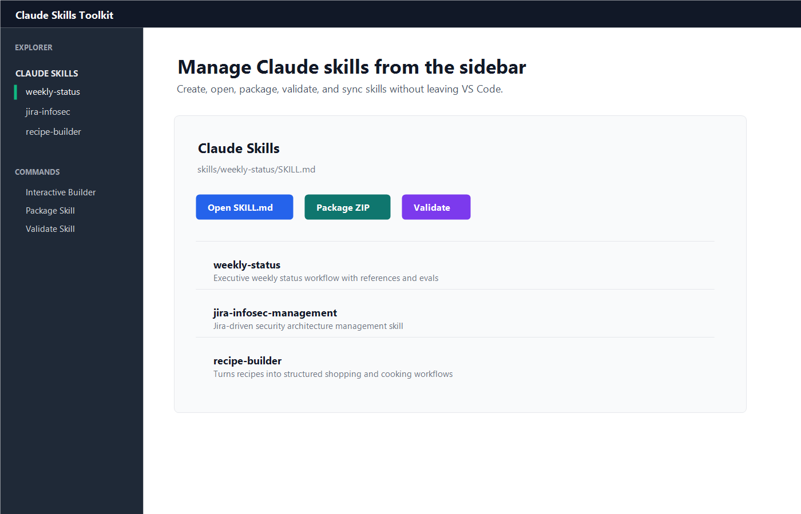
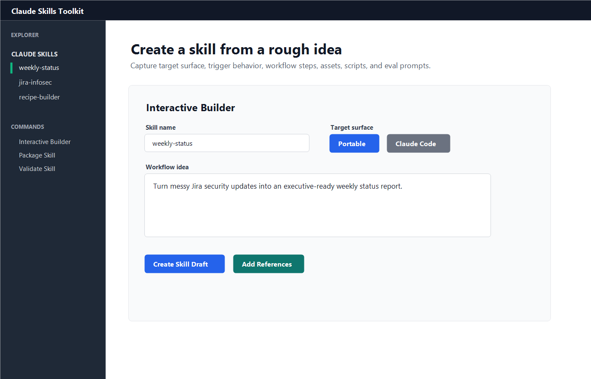
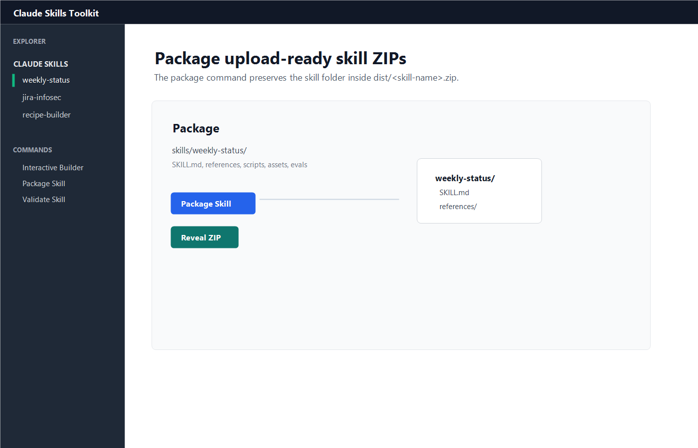
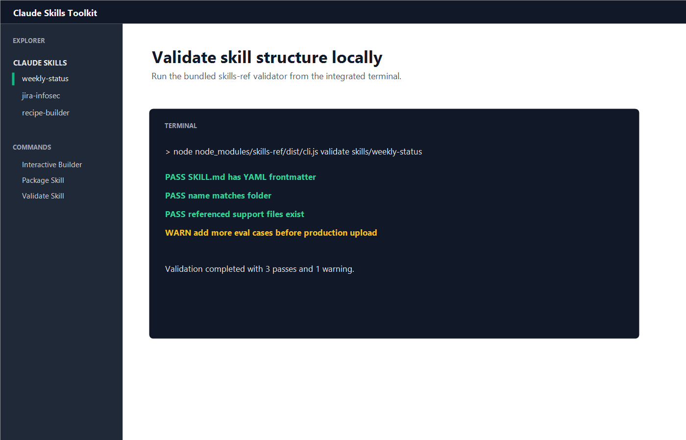

# Claude Skills Toolkit

Build, manage, validate, and package Claude-compatible skills directly from VS Code.

Claude Skills Toolkit gives Claude skill builders a small VS Code-native control panel for working with `SKILL.md` folders, generated skill structure, validation, and upload-ready ZIP packages.

[Install from the VS Code Marketplace](https://marketplace.visualstudio.com/items?itemName=DavidFarris.skill-builder)

## Screenshots









## What It Does

- Creates Claude-compatible skill folders with `SKILL.md`, `references/`, `scripts/`, `assets/`, and `evals/`.
- Opens and edits skill metadata, workflow modules, files, evals, and package actions from a VS Code webview.
- Packages skills into upload-ready ZIP files for Claude.ai.
- Runs bundled validation from the VS Code terminal.
- Syncs local skills into Claude Code's personal skill folder.
- Imports and publishes skill folders through configurable Git workflows.
- Helps turn rough skill ideas into structured drafts without forcing a rigid form.

## Quick Start

1. Install [Claude Skills Toolkit](https://marketplace.visualstudio.com/items?itemName=DavidFarris.skill-builder).
2. Open a workspace in VS Code.
3. Open the Explorer sidebar.
4. Find the `Claude Skills` view.
5. Run `Skill Builder: Interactive Builder`.
6. Describe the skill workflow you want.
7. Click `Create Skill Draft`.

The toolkit creates a starter `SKILL.md`, starter evals, and an optional workbench brief from one form.

## Expected Folder Structure

Claude skill deliverables live under `skills/`:

```text
skills/
  my-skill/
    SKILL.md
    references/
    scripts/
    assets/
    evals/evals.json
```

Authoring notes live outside the packaged skill:

```text
workbench/
  my-skill/
    brief.md
    creation-plan.md
    authoring-prompt.md
```

Packaged ZIP files are written to:

```text
dist/
  my-skill.zip
```

## Commands

- `Skill Builder: Interactive Builder` opens the free-form skill intake UI.
- `Skill Builder: Open Skill Editor` opens the tabbed metadata, modules, files, evals, and package editor.
- `Skill Builder: Create Skill` creates a minimal starter skill through prompts.
- `Skill Builder: Open Skill` opens the selected `SKILL.md`.
- `Skill Builder: Add Supporting Files` copies docs, scripts, or assets into a skill.
- `Skill Builder: Package Skill` creates a Claude.ai upload ZIP.
- `Skill Builder: Sync to Claude Code` copies a skill to the Claude Code skills folder.
- `Skill Builder: Import/Update Skill from Git` pulls one skill folder from a Git repository into the local `skills/` directory.
- `Skill Builder: Publish Skill to Git` commits and pushes a configured skill path through the manual publish script.
- `Skill Builder: Validate Skill` runs the bundled `skills-ref` validator.
- `Skill Builder: Health Check` opens a local structure and quality report.
- `Skill Builder: Copy Free-Form Chat Prompt` copies a prompt for deeper skill authoring work with an AI assistant.

## Create Skills From Rough Ideas

Use `Skill Builder: Interactive Builder` when you are still thinking out loud.

Example:

```text
I need a skill that turns messy Jira security architecture updates into a weekly executive-ready status report. It should use our preferred sections, flag blockers, and create copy I can paste into Confluence.
```

The builder can capture:

- target surface: portable, Claude.ai, Claude Code, or Claude API
- trigger description
- should-trigger and should-not-trigger examples
- inputs Claude should gather
- workflow steps and edge cases
- references, scripts, and assets
- eval prompts
- security and external-system assumptions

## Package For Claude.ai

Right-click a skill in the `Claude Skills` tree and choose:

```text
Skill Builder: Package Skill
```

The toolkit writes:

```text
dist/<skill-name>.zip
```

The ZIP preserves the skill folder inside the archive, which is the structure Claude.ai expects for custom skill upload.

## Validate A Skill

Right-click a skill and choose:

```text
Skill Builder: Validate Skill
```

The command opens an integrated terminal and runs the bundled validator:

```bash
node "<extension-folder>/node_modules/skills-ref/dist/cli.js" validate "<skill-path>"
```

A global `skills-ref` install is not required.

## Sync To Claude Code

Right-click a skill and choose:

```text
Skill Builder: Sync to Claude Code
```

By default, the toolkit copies the skill to:

```text
~/.claude/skills/<skill-name>/
```

You can override the destination with `skillBuilder.claudeCodeSkillsDirectory`.

## Git Workflows

Claude Skills Toolkit includes manual Git import and publish helpers.

For publishing, copy the example config first:

```bash
cp skill-builder.config.example.json skill-builder.config.json
```

Then set `git.enabled` to `true` and review the remote, branch prefix, validation, and include rules.
When you run `Skill Builder: Publish Skill to Git`, you can pick from detected Git remotes or enter a Git remote name, repository URL, or local repository path for that publish.

The publisher can handle:

- a workspace skill
- a selected `SKILL.md`
- an Anthropic `.skill` package file
- an extracted skill folder

External selections are copied into the workspace before Git staging so the publish command can commit them cleanly.

## Settings

- `skillBuilder.skillsDirectory`: workspace-relative skill source directory. Default: `skills`.
- `skillBuilder.distDirectory`: ZIP output directory. Default: `dist`.
- `skillBuilder.claudeCodeSkillsDirectory`: sync destination for Claude Code. Default: `~/.claude/skills`.
- `skillBuilder.projectRoot`: optional project root override.

## Requirements

- VS Code `1.90.0` or newer.
- Node.js only for local development or direct script use.
- Git only for import or publish workflows.
- No global `skills-ref` install is required; the extension bundles its validator dependency.

## What This Extension Does Not Do

Claude Skills Toolkit does not upload skills into Claude.ai or the Claude API for you. It prepares the local folder or ZIP artifact.

It also does not run Claude inside VS Code. The interactive builder creates a strong local draft and optional authoring prompt, but deeper refinement still happens by editing the generated files or using your preferred AI assistant.

## Official References

- [How to create a skill with Claude through conversation](https://support.claude.com/en/articles/12599426-how-to-create-a-skill-with-claude-through-conversation)
- [How to create custom Skills](https://support.claude.com/en/articles/12512198-how-to-create-custom-skills)
- [Use Skills in Claude](https://support.claude.com/en/articles/12512180-use-skills-in-claude)
- [Using Agent Skills with the API](https://platform.claude.com/docs/en/build-with-claude/skills-guide)
- [Extend Claude with skills in Claude Code](https://code.claude.com/docs/en/skills)
- [Anthropic skills repository](https://github.com/anthropics/skills)

## Development

Install dependencies:

```bash
npm install
```

Compile:

```bash
npm run compile
```

Package:

```bash
npm run package
```

Publish a configured skill:

```bash
npm run publish-skill -- my-skill
```

## License

MIT License. See [LICENSE](LICENSE).
